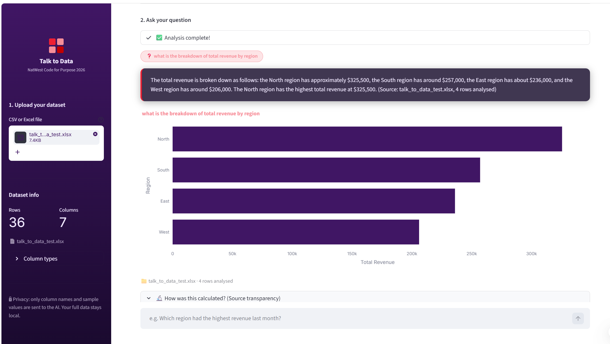
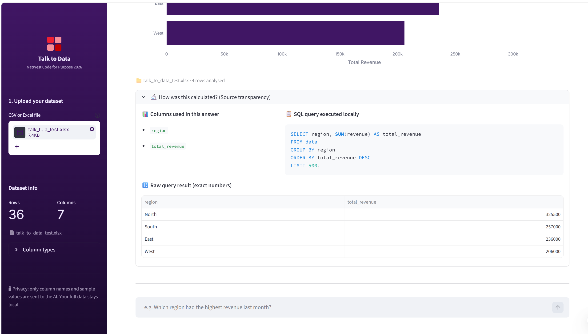

# Talk to Data — Seamless Self-Service Intelligence


## Overview
**Talk to Data** is an enterprise-grade, privacy-preserving conversational analytics application built for the NatWest Code for Purpose Hackathon. 





Many non-technical users struggle to get quick, trustworthy answers from their data due to complex tools and unclear terminology. This project democratizes data access by allowing users to upload any CSV or Excel file and ask questions in plain English. By prioritizing **Clarity**, **Trust**, and **Speed**, the application bridges the gap between raw data and actionable business insights.

## Features
- **Instant Conversational Analytics**: Ask complex analytical questions (e.g., "Why did revenue drop last month?") and receive plain-English, jargon-free explanations.
- **Privacy-First Local Execution**: Uses in-memory `DuckDB` to query data locally on your machine. **Your raw data never leaves the session;** only schema metadata (like column names) is sent to the LLM APIs.
- **Explainable AI (XAI)**: Every answer includes a "How was this calculated?" transparency expander that reveals the exact SQL query executed, the columns used, and any temporal assumptions the AI made.
- **Enterprise Security**: Implements a strict two-layer defense mechanism (AST parsing via `sqlparse` + keyword blocklists) to guarantee safety from SQL injection or data mutation.
- **Ambiguity Detection**: If a user asks a vague question (e.g., "Show top products"), the system automatically intercepts it and asks for clarification ("Top by what metric?") instead of guessing.
- **Dynamic Visualizations**: Automatically selects and renders beautiful Plotly charts (bar, line, pie) styled in the official NatWest brand palette.

## Tech Stack
- **Frontend Framework**: Streamlit (Python)
- **Data Engine**: DuckDB, Pandas
- **Visualization**: Plotly Express, Plotly Graph Objects
- **LLM Orchestration**: Groq API (Primary), Google Gemini API (Fallback)
- **Security & Parsing**: `sqlparse`

## Installation and Run Instructions

1. **Clone the repository:**
   ```bash
   git clone https://github.com/abhayjeet5465/talk-to-data
   cd talk-to-data
   ```

2. **Set up your environment:**
   We recommend using a virtual environment (optional but best practice):
   ```bash
   python -m venv venv
   source venv/bin/activate  # On Windows use: venv\Scripts\activate
   ```

3. **Install dependencies:**
   ```bash
   pip install -r requirements.txt
   ```

4. **Configure your API keys:**
   Copy the example environment variables file and add your free tier API keys for Groq and Gemini.
   ```bash
   cp .env.example .env
   ```
   *(Note: The system acts resiliently and will warn you via the UI if keys are missing.)*

5. **Run the application:**
   ```bash
   streamlit run app.py
   ```

## Usage Examples

1. **Upload your file:** Use the main sidebar to upload your own `sales_sample.csv` or `.xlsx` file. A dataset info panel will appear, detailing your rows, columns, and data types.
2. **Ask a question:** Type into the chat input:
   > *"What is the breakdown of units sold by region?"*
3. **View the analysis:** The system will process your query via the step-by-step UI tracer and display:
   - A plain-English summary (e.g., *"The lowest performing region was South, selling only 30 units."*) 
   - A perfectly formatted NatWest branded chart.
4. **Source Transparency:** Click the "How was this calculated?" expander below the answer to view the generated SQL, confirming the insights are rooted entirely in mathematical fact.

## Architecture & Technical Depth

Building a text-to-SQL pipeline that doesn't hallucinate requires strict boundaries. We utilized the following advanced techniques:

- **Chain-of-Thought (CoT) Prompting:** Our SQL generator prompt forces the LLaMA model to write a step-by-step reasoning plan inside `<logic>` XML tags *before* outputting the final SQL schema. We discard the logic programmatically. This slows inference down by milliseconds but exponentially increases SQL accuracy.
- **AST Security Validation:** Regex-based SQL security is easy to bypass. We route all AI-generated queries through an Abstract Syntax Tree (AST) validator using the `sqlparse` library to guarantee the root operation is strictly a `SELECT` statement before DuckDB ever touches the execution layer.
- **Orchestrator Self-Correction:** When the LLM occasionally hallucinates a column name, our custom `run_query` orchestrator catches the DuckDB runtime error and feeds the traceback back to the LLM for one single, hidden self-correction attempt.

## Development & Testing
The project uses `pytest` heavily to guarantee pipeline stability.
To run the full suite:
```bash
python -m pytest tests/ -v
```

## Limitations
- **Cross-file querying**: Currently, the system supports analyzing one uploaded dataset at a time. It does not support joining multiple uploaded files.
- **Extreme Scale**: Because `DuckDB` runs in-memory, the file upload is capped at 50MB via Streamlit's config to prevent memory exhaustion on local hardware.

## Future Improvements
- **Semantic Dictionary Integration**: Allow companies to upload a JSON dictionary of defined metrics (e.g. `{"active_user": "logged in within 30 days"}`) and inject this dynamically into the LLM prompt.
- **Export to PDF**: Add a button to export the generated narrative and Plotly chart into a downloadable PDF report for management.

## Licensing & Compliance
This project is licensed under the Apache License 2.0. All commits are signed off under the Developer Certificate of Origin (DCO).
