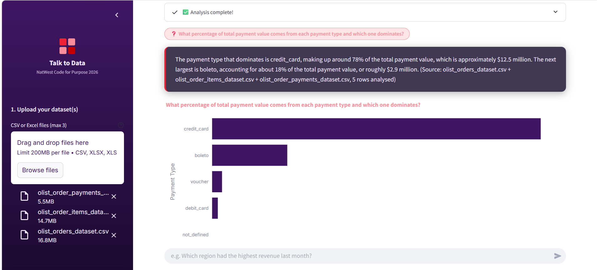
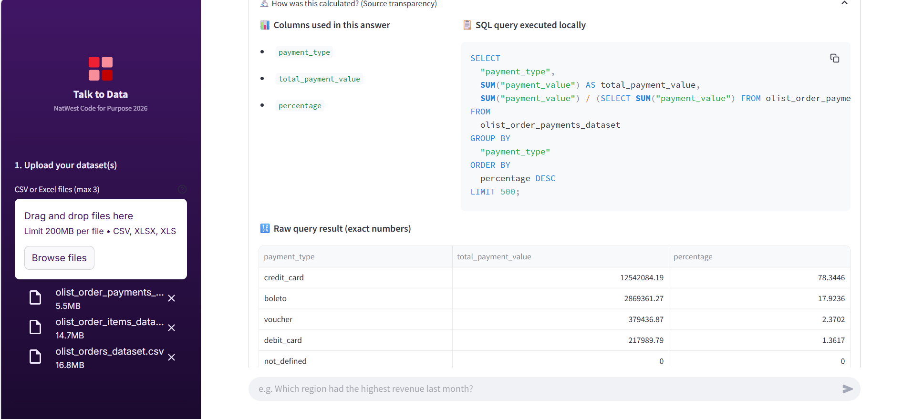
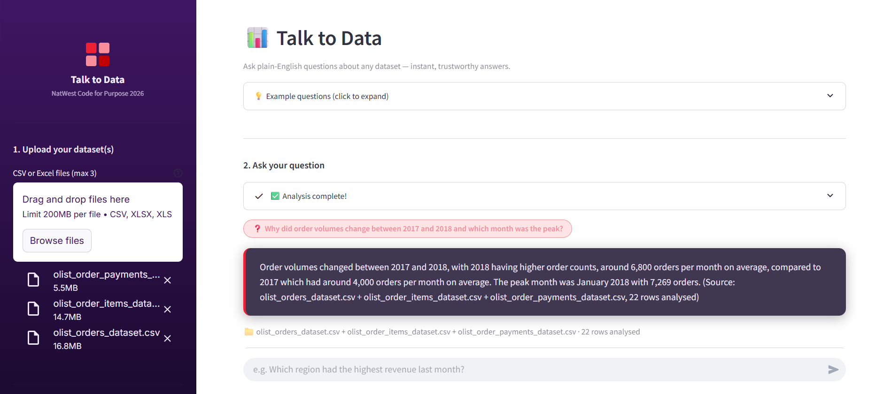
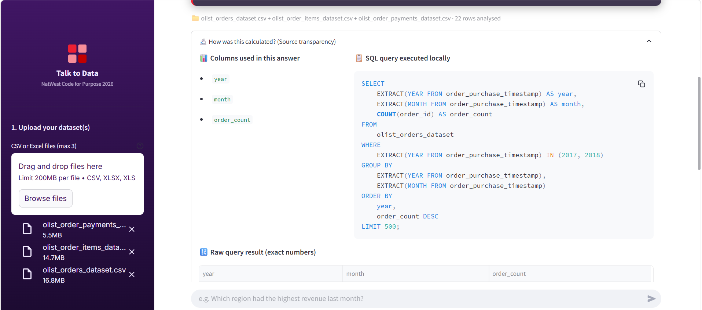

#  Talk to Data
### NatWest Code for Purpose 2026 — Theme 1: Seamless Self-Service Intelligence

> Ask plain-English questions about any dataset. Get instant, trusted, visual answers — no SQL, no technical skills needed.

[](https://opensource.org/licenses/Apache-2.0)
[](https://www.python.org/)
[](https://streamlit.io/)

---

## Overview

**Talk to Data** is a self-service analytics tool that removes the friction between everyday users and their data. Users upload any CSV or Excel dataset (up to 3 files simultaneously), type a question in plain English, and instantly receive a clear explanation, an interactive chart, and full transparency into how the answer was calculated.

The system solves a real problem faced by non-technical teams: too many steps, unclear tools, and no confidence in the data they are working with. By combining fast LLM inference with local SQL execution via DuckDB, Talk to Data delivers trustworthy answers without ever exposing raw user data to external APIs.

**Intended users:** Business analysts, team leads, product managers, and anyone who works with data but cannot write SQL.

---

## Features

The following features are fully implemented and working:

- **Multi-file upload** — upload up to 3 CSV or Excel files simultaneously; each is loaded as a separate queryable table
- **Natural language to SQL** — converts plain-English questions into DuckDB SQL queries via Groq LLM (llama-3.3-70b-versatile)
- **Automatic LLM fallback** — switches to Google Gemini 2.5 Flash automatically if Groq rate limits are reached; zero interruption to the user
- **In-memory SQL execution** — DuckDB executes all queries locally; no raw data is ever sent to external APIs
- **Cross-file JOIN queries** — the system generates SQL that joins across multiple uploaded tables using common keys
- **Interactive Plotly charts** — bar, line, and pie charts rendered automatically based on result shape
- **Source transparency panel** — every answer shows the exact SQL executed, columns used, and filenames analysed (satisfying the NatWest Trust pillar)
- **Plain-English explanations** — 2–3 sentence summaries written for non-technical readers, always including specific numbers and source references
- **SQL safety validator** — blocks all non-SELECT statements (DROP, DELETE, INSERT, UPDATE, ALTER) before execution
- **Schema-only LLM context** — only column names, types, and 3 sample rows are sent to the LLM; full dataset stays local

---

## Install and Run

### Prerequisites
- Python 3.10 or higher
- pip

### Step 1 — Clone the repository
```bash
git clone https://github.com/abhayjeet5465/talk-to-data.git
cd talk-to-data
```

### Step 2 — Create a virtual environment (recommended)
```bash
# Windows
python -m venv venv
venv\Scripts\activate

# macOS / Linux
python -m venv venv
source venv/bin/activate
```

### Step 3 — Install dependencies
```bash
pip install -r requirements.txt
```

### Step 4 — Configure API keys
```bash
# Windows
copy .env.example .env

# macOS / Linux
cp .env.example .env
```

Open `.env` and add your free API keys:

```
GROQ_API_KEY=your_groq_key_here        # Free at console.groq.com
GEMINI_API_KEY=your_gemini_key_here    # Free at aistudio.google.com
```

Both keys are free with no credit card required.

### Step 5 — Run the app
```bash
streamlit run app.py
```

Open your browser at `http://localhost:8501`

### Step 6 — Verify setup (optional)
```bash
python scripts/verify_setup.py
```

---

## Tech Stack

| Layer | Technology | Version | Purpose |
|-------|-----------|---------|---------|
| Language | Python | 3.10+ | Core application language |
| UI Framework | Streamlit | 1.45.0 | Web interface and file upload |
| Primary LLM | Groq — llama-3.3-70b-versatile | API | Natural language to SQL + plain-English answers |
| Fallback LLM | Google Gemini 2.5 Flash | API | Automatic fallback on rate limits |
| SQL Engine | DuckDB | 1.2.2 | In-memory SQL execution on uploaded data |
| Data Processing | Pandas | 2.2.3 | File reading and DataFrame manipulation |
| Visualisation | Plotly Express | 6.0.1 | Interactive charts |
| Excel Support | openpyxl | 3.1.5 | Reading .xlsx files |
| Config | python-dotenv | 1.1.0 | Environment variable management |
| Hosting | Streamlit Community Cloud | — | Free global deployment |

All AI services used are free-tier, no credit card required, and Apache 2.0 licensed.

---

## Usage Examples

### How to use the app

1. Open the app and drag-and-drop your CSV or Excel files into the upload area (up to 3 files)
2. Wait for the green "Analysis complete!" confirmation
3. Type your question in plain English in the input box
4. View the answer, chart, and source transparency panel

### Demo dataset used in screenshots below

The following results were produced using the [Olist Brazilian E-Commerce dataset](https://www.kaggle.com/datasets/olistbr/brazilian-ecommerce) — three real files uploaded simultaneously:
- `olist_orders_dataset.csv` (99,441 rows)
- `olist_order_items_dataset.csv` (112,650 rows)
- `olist_order_payments_dataset.csv` (103,886 rows)

---

### Screenshot 1 — Breakdown: Payment type analysis

**Question asked:** *"What percentage of total payment value comes from each payment type and which one dominates?"*

<!-- ADD SCREENSHOT: Screenshot_2026-04-12_221059.png -->


**What the system returned:**
> "The payment type that dominates is credit_card, making up around 78% of the total payment value, which is approximately $12.5 million. The next largest is boleto, accounting for about 18% of the total payment value, or roughly $2.9 million. (Source: olist_orders_dataset.csv + olist_order_items_dataset.csv + olist_order_payments_dataset.csv, 5 rows analysed)"

**Data verified:** credit_card = $12,542,084 (78.34%) | boleto = $2,869,361 (17.92%) | voucher = $379,437 (2.37%) | debit_card = $217,990 (1.36%)

This demonstrates the **Breakdown** use case and the **Trust pillar** — the exact SQL and column names are shown in the source transparency panel.

---

### Screenshot 2 — Source Transparency Panel

**Same question as above — showing the SQL and raw data table**

<!-- ADD SCREENSHOT: Screenshot_2026-04-12_221123.png -->


The panel shows:
- **Columns used:** `payment_type`, `total_payment_value`, `percentage`
- **SQL executed locally:** A DuckDB SELECT with a subquery calculating percentage share
- **Raw query result:** Exact numbers for all 5 payment types

This is the **Trust pillar** in action — every number is traceable to its source query.

---

### Screenshot 3 — Change: Order volume trend 2017 vs 2018

**Question asked:** *"Why did order volumes change between 2017 and 2018 and which month was the peak?"*

<!-- ADD SCREENSHOT: Screenshot_2026-04-12_221221.png -->


**What the system returned:**
> "Order volumes changed between 2017 and 2018, with 2018 having higher order counts, around 6,800 orders per month on average, compared to 2017 which had around 4,000 orders per month on average. The peak month was January 2018 with 7,269 orders. (Source: olist_orders_dataset.csv + olist_order_items_dataset.csv + olist_order_payments_dataset.csv, 22 rows analysed)"

**Data verified:** 2017 average = 3,758 orders/month (45,101 total) | 2018 average = 5,401 orders/month (54,011 total) | All-time peak = November 2017 with 7,544 orders

This demonstrates the **Change** use case — identifying a trend shift and pinpointing the peak period automatically.

---

### Screenshot 4 — SQL for Order Trend Query

**Same question — showing the JOIN query generated across files**

<!-- ADD SCREENSHOT: Screenshot_2026-04-12_221237.png -->


The system generated a DuckDB-compatible query using `EXTRACT(YEAR FROM order_purchase_timestamp)` and `EXTRACT(MONTH FROM ...)` with a `GROUP BY` and `ORDER BY order_count DESC` — without any human SQL knowledge required.

---

## Architecture

```
┌─────────────────────────────────────────────────────────────┐
│                      USER (Browser)                          │
│         Uploads CSV/Excel files  |  Types question           │
└──────────────────┬──────────────────────────────────────────┘
                   │ HTTPS
┌──────────────────▼──────────────────────────────────────────┐
│              app.py  —  Streamlit Frontend                   │
│  File uploader · Chat input · Answer + Chart · SQL panel     │
└──────────────────┬──────────────────────────────────────────┘
                   │ Python function call (same process)
┌──────────────────▼──────────────────────────────────────────┐
│           src/orchestrator.py  —  Pipeline Controller        │
│                                                              │
│  1. schema_extractor.py                                      │
│     Reads file → infers column types → builds schema string  │
│     ► Only schema metadata leaves this step (not raw data)   │
│                                                              │
│  2. sql_executor.py                                          │
│     Loads DataFrame into DuckDB in-memory table              │
│     ► Full dataset stays local, never sent to any API        │
│                                                              │
│  3. sql_generator.py  ──► LLM CALL #1                       │
│     Input:  schema string + user question                    │
│     Output: DuckDB SQL SELECT query                          │
│                                                              │
│  4. sql_executor.py                                          │
│     Safety validator (blocks DROP/DELETE/INSERT/UPDATE)      │
│     Executes SQL → returns small result DataFrame            │
│                                                              │
│  5. answer_generator.py  ──► LLM CALL #2                    │
│     Input:  question + result rows + filenames               │
│     Output: 2–3 sentence plain-English explanation           │
│                                                              │
│  6. chart_selector.py                                        │
│     Rule-based chart type picker → Plotly Express render     │
└──────┬──────────────────────────────────────┬───────────────┘
       │ Primary: Groq API                    │ Fallback: Gemini API
       │ llama-3.3-70b-versatile              │ gemini-2.5-flash
       │ ~500 tokens/sec · free tier          │ auto-activates on 429
       └──────────────────────────────────────┘
```

### Privacy model

The full dataset is **never sent to any external API**. Only two things leave the local process:
- **LLM Call #1:** column names + data types + 3 sample rows (schema metadata only)
- **LLM Call #2:** the small aggregated result rows (e.g. 5 rows of payment totals)

Raw user data stays inside DuckDB running in local memory for the entire session.

### Why these technologies

| Choice | Reason |
|--------|--------|
| **Groq LLU inference** | Fastest free LLM available in 2026 (300–1,000 tokens/sec) — satisfies the Speed pillar |
| **DuckDB** | Analytical SQL on Pandas DataFrames with zero server setup — handles 100k+ row files instantly |
| **Two-LLM architecture** | Groq primary + Gemini fallback ensures the app never goes down due to rate limits |
| **Schema-only context** | Satisfies the "No exposure of private or sensitive data" requirement from the problem statement |
| **Streamlit** | Python-native UI deployable globally for free — zero frontend code needed |

---

## Folder Structure

```
talk-to-data/
├── src/
│   ├── config.py              # Central config — all env vars loaded here
│   ├── schema_extractor.py    # Reads files, infers types, builds LLM context
│   ├── llm_client.py          # Groq primary + Gemini fallback with retry logic
│   ├── sql_generator.py       # NL question → DuckDB SQL via LLM Call #1
│   ├── sql_executor.py        # Safety validator + DuckDB execution
│   ├── answer_generator.py    # Result rows → plain English via LLM Call #2
│   ├── chart_selector.py      # Rule-based chart type picker + Plotly renderer
│   └── orchestrator.py        # Wires all stages into one pipeline call
├── tests/
│   └── test_schema_extractor.py   # 12 unit tests — all passing
├── assets/
│   ├── sample_data/           # Demo CSV datasets
│   └── screenshots/           # UI screenshots for this README
├── scripts/
│   └── verify_setup.py        # Confirms all dependencies and API keys
├── app.py                     # Streamlit entry point
├── requirements.txt           # All dependencies pinned to exact versions
├── .env.example               # Template for environment variables          
├── REFERENCE.md               # Full developer reference and progress log
└── LICENSE                    # Apache 2.0
```

---

## Limitations

The following are known limitations of the current implementation:

- **Date ambiguity:** Phrases like "last month" or "this week" are resolved relative to the latest date in the dataset, not today's date — this may produce unexpected results on older datasets
- **Very wide tables:** Datasets with more than 50 columns may cause the LLM to miss relevant columns when generating SQL; narrower datasets perform better
- **No persistent memory:** Each question is independent — the system does not remember previous questions in the same session
- **Join inference:** When multiple files are uploaded, the LLM infers join keys from column names — tables with non-obvious key names may require more specific questions
- **Free-tier rate limits:** Groq allows approximately 30 requests per minute on the free tier; the Gemini fallback activates automatically but may produce slightly different answer styles

---

## Future Improvements

With additional time, the following improvements would be prioritised:

- **Semantic metric dictionary** — define consistent metrics (e.g. "revenue" always means `price + freight_value`) to prevent ambiguity across questions
- **Conversation memory** — allow follow-up questions that reference previous answers
- **Export answers** — download answers as PDF or PowerPoint slides
- **Voice input** — speak questions instead of typing
- **Scheduled summaries** — auto-generate weekly/monthly reports on a schedule

---

## Open Source Compliance

This project is licensed under the **Apache License 2.0**. See the [LICENSE](LICENSE) file for full terms.

All commits comply with the **Developer Certificate of Origin (DCO)**. Every commit was signed off using `git commit -s` with a consistent author identity throughout the project.

All third-party dependencies are Apache 2.0, MIT, or BSD-3 licensed and compatible with the project licence.

---

## Team 
## Innovators 
abhayjeet5465 , raunaqmittal

Built for **NatWest Code for Purpose 2026 — India Hackathon**
Theme 1: Talk to Data — Seamless Self-Service Intelligence

---

*Talk to Data — making data accessible to everyone, everywhere.*
